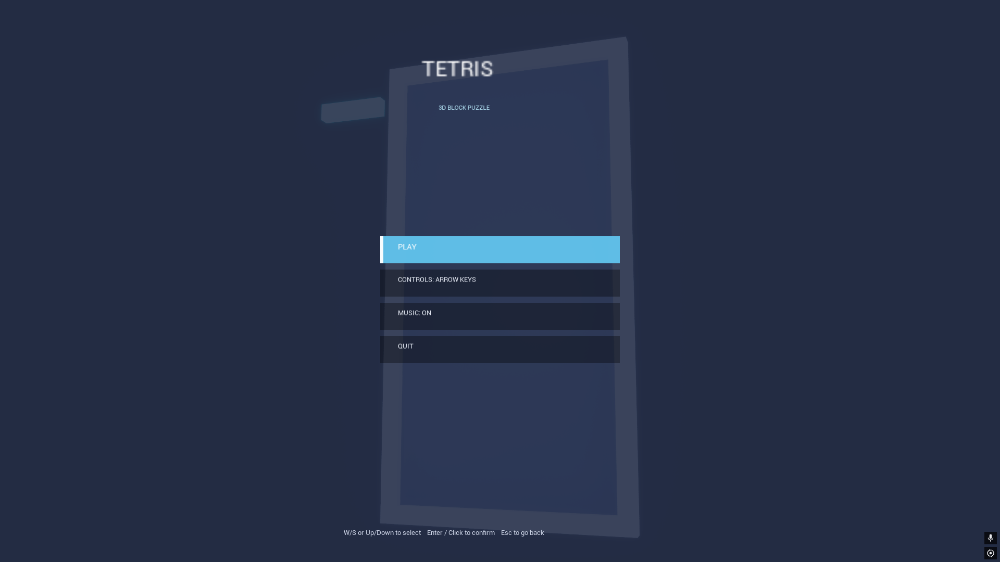
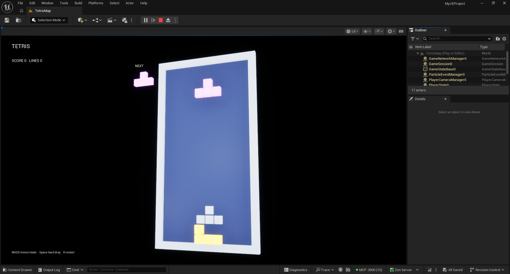
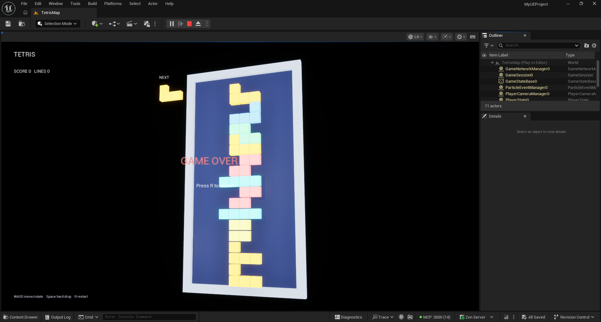
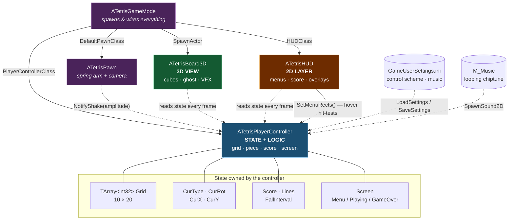
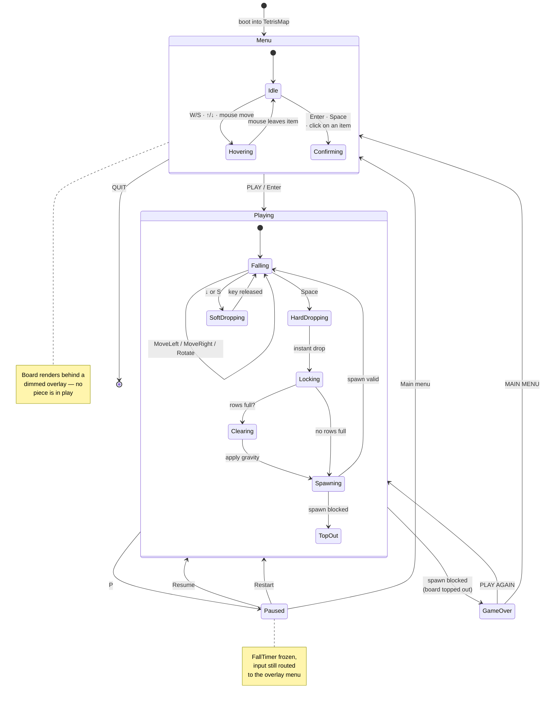
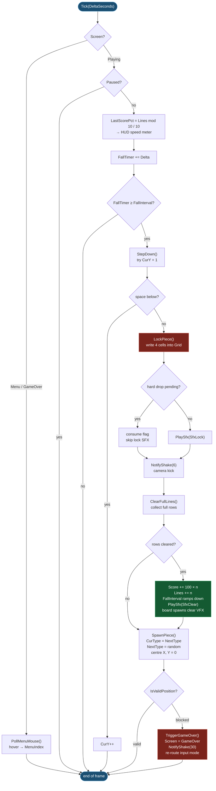
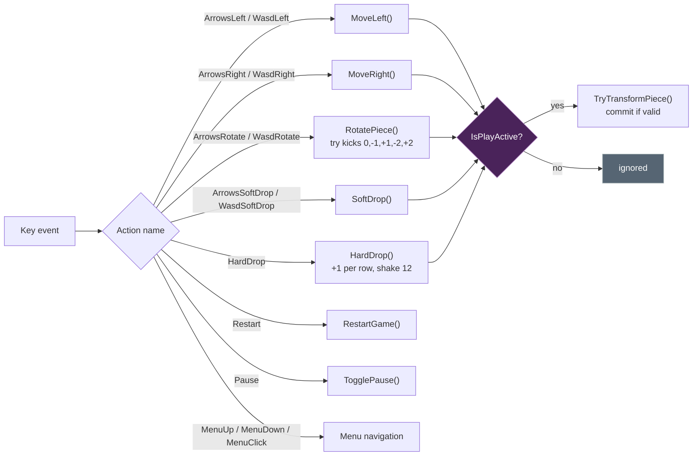

<div align="center">

# UNREAL-game

**A 3D Tetris built in Unreal Engine 5.8 — pure C++, no Blueprints.**

[](https://www.unrealengine.com/)
[](#-architecture)
[](#-playing-the-game)
[](#-license)



 

</div>

---

## Table of contents

- [What is this](#-what-is-this)
- [Playing the game](#-playing-the-game)
- [Controls](#-controls)
- [Features](#-features)
- [Project layout](#-project-layout)
- [How it works](#-how-it-works)
- [Building from source](#-building-from-source)
- [Driving the editor over MCP](#-driving-the-editor-over-mcp)
- [Screenshots pipeline](#-screenshots-pipeline)
- [Architecture](#-architecture)
- [Game lifecycle](#-game-lifecycle)
- [Gameplay loop](#-gameplay-loop)
- [Credits](#-credits)

---

## 🎮 What is this

A complete, playable 3D Tetris written entirely in C++ against the Unreal Engine
runtime. There are **no Blueprint assets** — the game mode, pawn, player controller,
HUD and the 3D board are all `UCLASS`es declared in
[`Source/MyUEProject/`](Source/MyUEProject/).

The board is a real 3D scene rather than a flat sprite grid. Every cell is a
`UStaticMeshComponent` cube sitting on a lit backplate, viewed through a spring-arm
camera. Pieces are lerped toward their target cell each frame, so horizontal moves
and gravity steps read as smooth motion rather than snapping.

| | |
|---|---|
| **Board** | 10 × 20 cells |
| **Pieces** | 7 tetrominoes (I, O, T, S, Z, J, L) with 4 rotations each |
| **Scoring** | `+100 × lines cleared`, `+1 per row travelled` on hard drop |
| **Difficulty** | fall interval ramps from `0.80s` down toward `0.15s` as lines clear |
| **Rendering** | one cube mesh per cell, instanced materials, camera shake feedback |
| **Audio** | 7 SFX cues + a procedurally generated 12.6s music loop |
| **Engine** | Unreal Engine 5.8 · Win64 · Shipping-ready |

---

## 🕹️ Playing the game

Grab the latest build from the
[**Releases**](https://github.com/yassine808/Tetris-game/releases) page.

1. Download and extract the archive.
2. Run `UNREAL-game.exe`.
3. The game boots into the **main menu** — pick a control scheme, hit **PLAY**.

The build is self-contained: no Epic Games Launcher, no Visual Studio and no
Unreal Engine install required on the target machine.

> Building it yourself? See [Building from source](#-building-from-source).

---

## 🎛️ Controls

Controls are **selectable from the main menu** and persist between runs, so you can
pick whichever scheme feels natural.

| Action | Arrow-key scheme | WASD scheme |
|---|---|---|
| Move left | `←` | `A` |
| Move right | `→` | `D` |
| Rotate | `↑` or `Z` | `W` |
| Soft drop | `↓` | `S` |
| Hard drop | `Space` | `Space` |
| Pause | `P` | `P` |
| Restart | `R` | `R` |

**In menus** — `W`/`S` or `↑`/`↓` to move the cursor, `Enter` or `Space` (or mouse
click) to confirm, `Esc` to go back.

The chosen scheme is written to the per-user config
(`Saved/Config/Windows/<Game>/GameUserSettings.ini`), so it survives restarts and
works in a packaged build where the install directory is read-only.

---

## ✨ Features

- **Main menu** — Play, control-scheme toggle, music toggle, Quit, drawn on the HUD
  canvas with keyboard *and* mouse hover/click navigation.
- **Selectable control schemes** — arrow keys or A/D/W/S, whichever you prefer.
- **Procedurally generated music** — an original 12.6s chiptune loop in C minor,
  synthesised from scratch by [`Tools/GenerateMusic.mjs`](Tools/GenerateMusic.mjs)
  (square/pulse/saw oscillators, ADSR-ish envelopes, kick and hats). No samples,
  no licensing. Toggleable from the menu.
- **Pause overlay** — `P` pauses; Resume / Restart / Main menu.
- **Game-over flow** — final score, Play Again, or return to the menu.
- **Speed ramp** — the board gets faster as you clear lines.
- **Ghost piece** — a translucent preview of where the current piece will land.
- **Next-piece preview** — rendered as a real 3D object beside the board.
- **Juice** — camera shake on lock, hard drop and line clear; cube pop animation on
  lock; debris and flash on a cleared row.
- **Editor automation** — the whole thing is drivable over MCP, which made the
  editor-side iteration loop fast.

---

## 📁 Project layout

```
UNREAL-game/
├── Config/                     # Engine, input and map configuration
│   ├── DefaultEngine.ini       #   → boots straight into TetrisMap
│   └── DefaultInput.ini        #   → both control schemes + menu bindings
├── Content/
│   ├── Maps/TetrisMap.umap     # The single playable level
│   ├── Materials/
│   │   ├── M_TetrisBlock.uasset#   Base block material
│   │   └── MI/                 #   Per-piece instances, ghost, backplate
│   └── Sounds/
│       ├── S_*.uasset          #   7 sound cues (move, rotate, drop, lock, clear, game over)
│       └── M_Music/            #   Looping music track
├── Plugins/
│   └── McpAutomationBridge/    # Editor-only MCP bridge (source-only, never ships)
├── SFXSource/                  # Raw .wav sources for the sound cues
├── Source/MyUEProject/
│   ├── TetrisGame.h / .cpp     # GameMode, Pawn, PlayerController, HUD
│   └── TetrisBoard3D.h / .cpp  # 3D board renderer
├── Tools/
│   ├── GenerateMusic.mjs       # Regenerates Content/Sounds/M_Music.wav
│   ├── make-release.ps1        # Zip + split the packaged build into 90 MB parts
│   └── capture-shots.ps1       # Boots the release and captures the README shots
└── Docs/                       # Screenshots used by this README
```

---

## 🔧 How it works

### The four classes

Everything hangs off `ATetrisGameMode`, which spawns the board and wires up the
other three:

- **`ATetrisPlayerController`** owns *all* game state — the 200-cell grid, the
  active piece, score, lines, and the current screen. It also handles input,
  settings persistence and music. It exposes read-only getters that the board and
  HUD query every frame.
- **`ATetrisBoard3D`** is a pure *view*. It never mutates game state. Each tick it
  asks the controller what is locked, where the active piece is, and where the
  ghost sits, then positions cubes to match.
- **`ATetrisHUD`** draws the 2D layer — score, speed meter, menus, overlays. The
  menu publishes hit-rects back to the controller so mouse hover can drive
  selection, and a click only confirms when it actually lands inside one of those
  rects — clicking empty canvas does nothing. The main menu, game-over menu and
  pause overlay all draw through one shared `DrawMenuList()`, so they get the same
  hit-rects for free.
- **`ATetrisPawn`** is just a spring-arm and a camera. It exists so it can shake.

Separating state (controller) from view (board + HUD) is what made the menu,
pause and game-over screens cheap to add: they are just different draw modes over
the same persistent board.

### Piece rotation

Rotations are computed in a local box (3×3 for most pieces, 4×4 for I and O) by
rotating clockwise `n` times. On rotation the controller tries a set of horizontal
kicks `{0, -1, 1, -2, 2}` so pieces can rotate next to a wall instead of refusing.

### Line clearing

Two passes: first collect every full row, tell the board to spawn its clear VFX,
then shift rows down from the top. The shift order keeps array indices valid as
content moves.

### Music generation

```bash
node Tools/GenerateMusic.mjs     # → Content/Sounds/M_Music.wav
```

The script synthesises bass, arpeggio, lead and drums into a float buffer, normalises
to −1 dBFS and writes 16-bit PCM. Re-run it and re-import to iterate on the track.

---

## 🏗️ Building from source

**Requirements:** Unreal Engine 5.8, Visual Studio 2022 with the C++ game
development workload (MSVC 14.44 and the Windows 10/11 SDK were used here).

### Open in the editor

Double-click `MyUEProject.uproject`, or:

```powershell
& "C:\Path\To\UE_5.8\Engine\Binaries\Win64\UnrealEditor.exe" `
   "D:\Projects\UNREAL-game\MyUEProject.uproject"
```

### Compile the editor module

```powershell
& "C:\Path\To\UE_5.8\Engine\Build\BatchFiles\Build.bat" `
   MyUEProjectEditor Win64 Development `
   -Project="D:\Projects\UNREAL-game\MyUEProject.uproject" -WaitMutex
```

> **Close the editor first.** Live Coding holds the build lock and UBT will refuse
> with `Unable to build while Live Coding is active`.

### Package a distributable build

```powershell
& "C:\Path\To\UE_5.8\Engine\Build\BatchFiles\RunUAT.bat" BuildCookRun `
   -project="D:\Projects\UNREAL-game\MyUEProject.uproject" `
   -platform=Win64 -clientconfig=Shipping `
   -cook -build -stage -pak -archive `
   -archivedirectory="D:\Projects\UNREAL-game\Packaged"
```

> **Note:** `GameDefaultMap` in `Config/DefaultEngine.ini` must point at
> `/Game/Maps/TetrisMap`. It originally pointed at the engine's `OpenWorld`
> template, which meant a packaged build would have booted into an empty world.

> **Gotcha — string-loaded assets are invisible to the cooker.** The cooker
> discovers content by following hard references *out of cooked packages*: the
> map, blueprints, config. It never scans C++ source for paths, so every asset
> this project reaches with `LoadObject<...>(nullptr, TEXT("/Game/..."))` — all
> 10 material instances, 7 sound cues and the music — was silently dropped from
> the cook. The packaged build ran fine but drew **grey default-material pieces
> and no audio at all**, because `ensureMsgf()` around those calls compiles out
> of Shipping.
>
> `Config/DefaultGame.ini` fixes it with
> `DirectoriesToAlwaysCook=(Path="/Game/...")`, which forces those folders in
> regardless of references. If you add a string-loaded asset folder, add it
> there too. You can verify a cook with
> `Saved/Cooked/<Platform>/<Project>/Metadata/DevelopmentAssetRegistry.bin` —
> grep it for your asset names.

---

## 🤖 Driving the editor over MCP

The [`McpAutomationBridge`](Plugins/McpAutomationBridge/) plugin exposes a native
MCP server on `http://127.0.0.1:3000/mcp`, gated by a capability token written to
`Saved/MCP/capability-token`. It is **editor-only** (both modules are `Type:
Editor`), so nothing from it reaches a packaged build.

Everything in this repo's workflow was driven through it: loading the map, starting
and stopping Play-In-Editor, simulating keystrokes to play the game, capturing
screenshots, and importing the generated music.

> **Gotcha worth knowing:** the bridge only loads when the editor is launched *with
> a project*. Starting a bare `UnrealEditor.exe` silently leaves the MCP server
> dead even though the config and token are correct.

A minimal client needs three things: the capability token header, the `initialize`
→ `notifications/initialized` handshake, and a single `unreal` gateway tool that
you drive with `search` → `describe` → `execute`. Consent-gated capabilities need a
grant object as a **sibling of `params`**, not nested inside it, and each grant's
nonce is single-use.

---

## 🖼️ Screenshots pipeline

The screenshots in this README are real captures from the **packaged Shipping
build**, not mockups and not editor captures:

1. `Tools/capture-shots.ps1` launches `UNREAL-game.exe` from the reassembled
   release, then focuses the window.
2. A raw `CopyFromScreen` capture saves the **main menu**.
3. `Enter` starts a game; scripted key taps hard-drop pieces until a board has
   built up — that frame is the **gameplay** shot.
4. Play continues until the stack tops out. A detector scans the frame for the
   saturated-red `GAME OVER` banner and only then saves the **game over** shot.
5. Files land in `Docs/` and are referenced at the top of this README.

Capturing from the shipping build matters: it is the exact artifact players run,
so the shots prove the shipped colours, the cooked assets and the HUD all render —
which is precisely what an editor capture can silently get wrong.

---

## 🏛️ Architecture



The important relationship is the one-way arrow: **the board and HUD read from the
controller and never write back**. That single rule is why adding menus and pause
screens did not require touching the simulation.

---

## 🔄 Game lifecycle



Every transition through `Playing` re-routes input mode: menus, the game-over
overlay and the pause overlay show the cursor and release mouse capture, gameplay
re-captures permanently. A click only confirms when it lands inside a published
hit-rect — clicking empty canvas does nothing.

---

## 🔁 Gameplay loop



User input branches off the same controller, gated by the same `IsPlayActive()`
check so keys do nothing on the menu:



Both schemes are bound simultaneously; the controller simply refuses keys that do
not belong to the active scheme, which is what makes the in-menu toggle work
without rebinding anything at runtime.

---

## 📜 Credits

- **Game code** — original C++, written for this project.
- **Music** — original chiptune, procedurally generated by
  [`Tools/GenerateMusic.mjs`](Tools/GenerateMusic.mjs). No third-party audio.
- **MCP automation** — [`McpAutomationBridge`](Plugins/McpAutomationBridge/) by
  ChiR24 (v0.6.0-beta-c), vendored as source and used in the editor only.
- **Engine** — Unreal Engine 5.8 by Epic Games.

## 📄 License

MIT — see [LICENSE](LICENSE).
